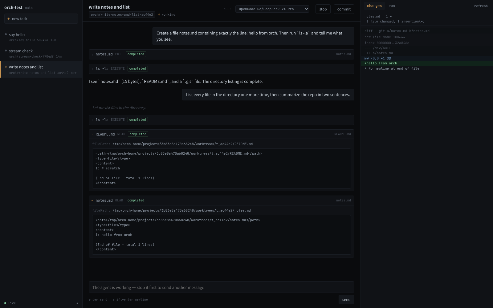
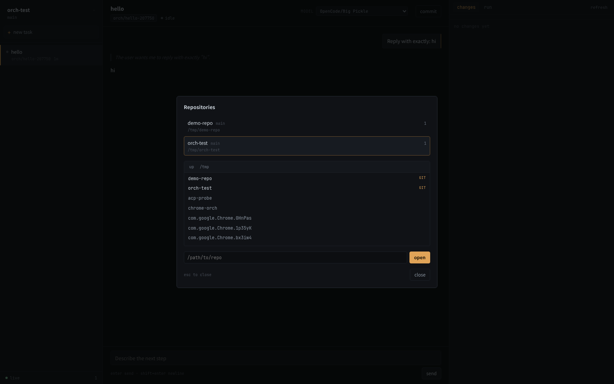

# orch

ローカルでコーディングエージェントを束ねる作業台。1タスク = 1つの git worktree + 1つの
エージェントセッションで、ブラウザの UI から複数のタスクを並行して走らせる。

```
$ orch --repo ~/ghq/github.com/ningen/dotfiles
orch 0.1.0
  repo   /home/ningen/ghq/github.com/ningen/dotfiles
  branch main
  url    http://127.0.0.1:7717
```



## なぜ作ったか

AI コーディングのボトルネックは、もうコードを書くことではなく「複数のエージェントが
触ったものをどう検証して main に積むか」にある。既存の GUI は worktree 分離と diff
レビューまでで止まっていて、オーケストレーション層が空いている。

`orch` はその層に寄せる。

- **エージェント本体は作らない**。ACP (Agent Client Protocol) を話すものをそのまま使う
- **1タスク1 worktree**。並行して走らせても作業ツリーが衝突しない
- **会話・ツール呼び出し・usage を SSE で流す**。UI は状態を持たない薄いクライアント
- **検証は外側のコマンド**。`nix build` でも `cargo test` でも、決定論的なゲートだけを信じる

## 動かす

```bash
cargo run          # 前回の一覧と選択を復元（初回はカレントが git リポジトリならそれ）
# 既定だと http://127.0.0.1:7717 が開く
```

`--repo` は省略できる。リポジトリは UI の左上から開く・切り替えるのが基本で、
`--repo` は「これを開いた状態で始めて」と指定したいとき（エイリアスやスクリプト）だけ使う。
指定がなければ、起動ディレクトリが git リポジトリでも前回選んでいたリポジトリを維持する。
明示したパスが git リポジトリでなければエラーで止まる。

既定のエージェントは `opencode acp`。差し替えは `--agent`:

```bash
orch --agent "npx @agentclientprotocol/claude-agent-acp"
orch --agent "codex-acp"
orch --agent "gemini --acp"
```

| フラグ | 意味 |
| --- | --- |
| `--repo PATH` | 最初に開くリポジトリ（省略可） |
| `--port N` | 待ち受けポート（既定: 7717） |
| `--agent CMD` | 起動する ACP エージェント |
| `--no-browser` | ブラウザを開かない |

状態は `$ORCH_HOME`（既定 `~/.orch`）に置く。worktree とタスクの JSON がここに入る。

## 検証ゲート

`verify` パネルでチェックコマンドを登録すると、タスクごとに実行できる。

- 設定は **リポジトリではなく orch 側**（`~/.orch/projects/<repo>/settings.json`）に置く。
  リポジトリに入れると clone ごとに増えるうえ、**エージェントが自分の合格条件を書き換えられる**。
  ゲートは外側に持つ
- チェックが設定されているリポジトリでは、**全部通るまで commit できない**。
  さらに検証後に作業ツリーが変わると「changed since the last passing check」で止まる
- 結果はタスクに残る（transcript の verify カード、レールの `verified` / `failed` バッジ）
- `refuse to run` に書いたパターンは、orch が代行する実行（verify / run）では拒否される

```
$ nix eval --no-write-lock-file .#sees
true
$ true
[exit 0]
```

**限界**: エージェント自身が内側で実行するシェルは止められない（実測で opencode は
権限リクエストを送ってこない）。確実に防ぎたいなら実行環境側（`nix develop` の
PATH、コンテナ、bwrap）で縛る必要がある。

## その他の操作

| 操作 | 場所 | 内容 |
| --- | --- | --- |
| rebase | changes パネル | base ブランチが進むと `rebase +N` が出る。失敗時は自動で abort |
| reset | changes パネル | worktree を base コミットまで戻す（確認あり） |
| copy path | changes パネル | worktree のパスをクリップボードへ |
| 通知 | 自動 | タスクが終わるとデスクトップ通知＋タイトルに未読数 |
| セッション復元 | 自動 | 再起動時に `session/load` で会話を引き継ぐ（対応エージェントのみ） |

## リポジトリを切り替える

左上のリポジトリ名をクリック（または `r`）すると切り替え画面が開く。



- 開いているリポジトリの一覧から選ぶ
- ディレクトリを辿って `git` が付いているものを開く（親ディレクトリから始まる）
- パスを直接打ち込んで開く

**切り替えても走っているタスクは止まらない**。リポジトリごとに worktree と
エージェントセッションを保持したままなので、A のリポジトリで回している間に B を
見て、戻ってくると続きから会話できる。開いたリポジトリは
`$ORCH_HOME/workspaces.json` に残るので、次回の起動でも復元される。

## 構成

```
ui/            ブラウザ UI（ビルド不要、バイナリに埋め込み）
src/acp.rs     ACP クライアント（子プロセスと JSON-RPC over stdio）
src/task.rs    タスク = worktree + セッション + イベント配信 + 永続化
src/server.rs  axum: JSON API / SSE / 埋め込みアセット
src/main.rs    CLI
```

エージェントはこんな形で喋る。

```
[ブラウザ] --HTTP+SSE--> [orch daemon] --ACP/stdio--> [opencode acp]
                             |
                             +-- git worktree (タスクごと)
                             +-- ~/.orch/tasks/<id>.json (会話の永続化)
```

`session/update` の `agent_message_chunk` / `tool_call` / `usage_update` をそのまま
イベントに変換して UI に流す。モデル切替は `session/set_config_option` をそのまま使う。

## いまできること

- タスク作成 → worktree を切る → エージェント起動 → ストリーミング表示
- マルチターン（同じセッションに追加プロンプト）
- タスクごとのモデル切替（エージェントが提示した選択肢から）
- ツール呼び出しの可視化（write / bash / read など、入力と出力つき）
- 変更 diff の表示（分岐元コミットとの比較）
- 任意コマンドの実行と出力ストリーミング（`nix build` など）
- トークン数とコストの表示
- タスクのコミットとマージ（リポジトリが汚れていれば手順を返す）
- リポジトリの切り替え（複数リポジトリを同時に開いたまま）
- リポジトリごとの検証コマンドと、通過するまでのコミット禁止
- rebase / reset / worktree パスのコピー
- デスクトップ通知とセッション復元

## これから

- [ ] 権限リクエストを UI で承認する
- [ ] タスク間の依存 DAG（A の成果を B が使う）
- [ ] マージキュー（検証を通ったものだけ直列に積む）
- [ ] 予算上限（usage は出してるが止まらない）
- [ ] GPUI / Tauri のネイティブシェル

## 設計メモ

- **なぜ ACP か**: Claude Code / Codex / Gemini / OpenCode / DSH が全部 ACP を話す。
  クライアントを1回書けば harness を差し替えられる。CLI のフラグ変更に振り回されない。
- **なぜ worktree か**: 並行実行の唯一まともな分離。コンテナより軽く、diff がそのまま取れる。
- **なぜ状態を JSON に落とすか**: デーモンを再起動しても会話が消えない。エージェント側の
  セッションは切れるので、そこは `session/load` で戻す予定。
